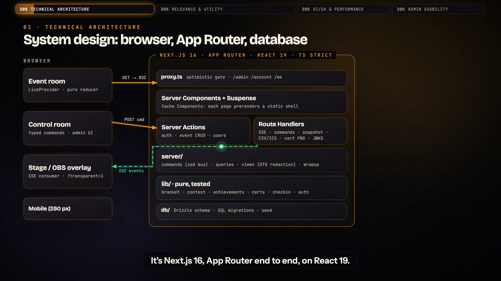
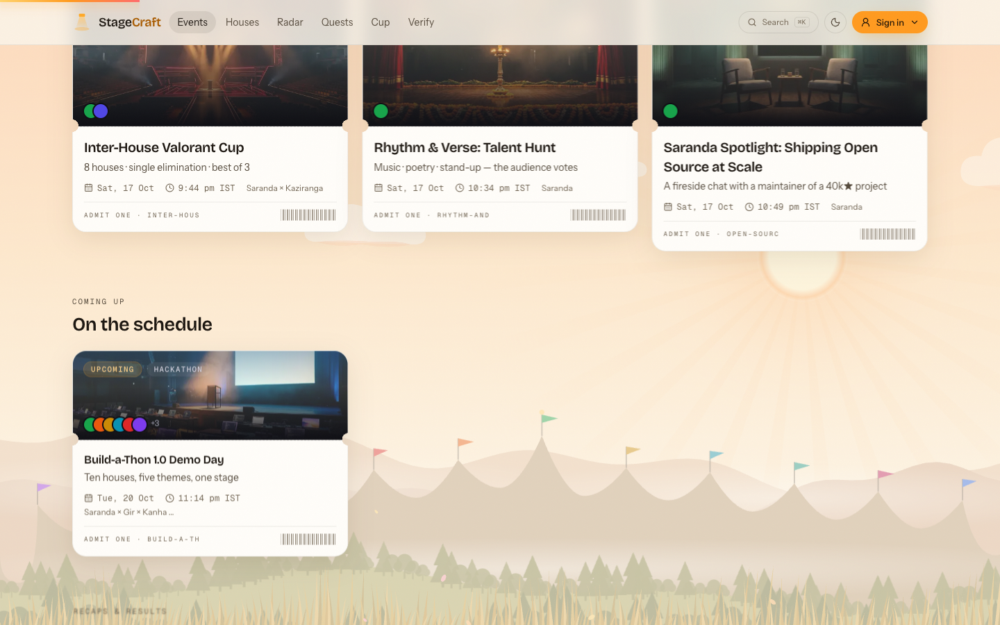
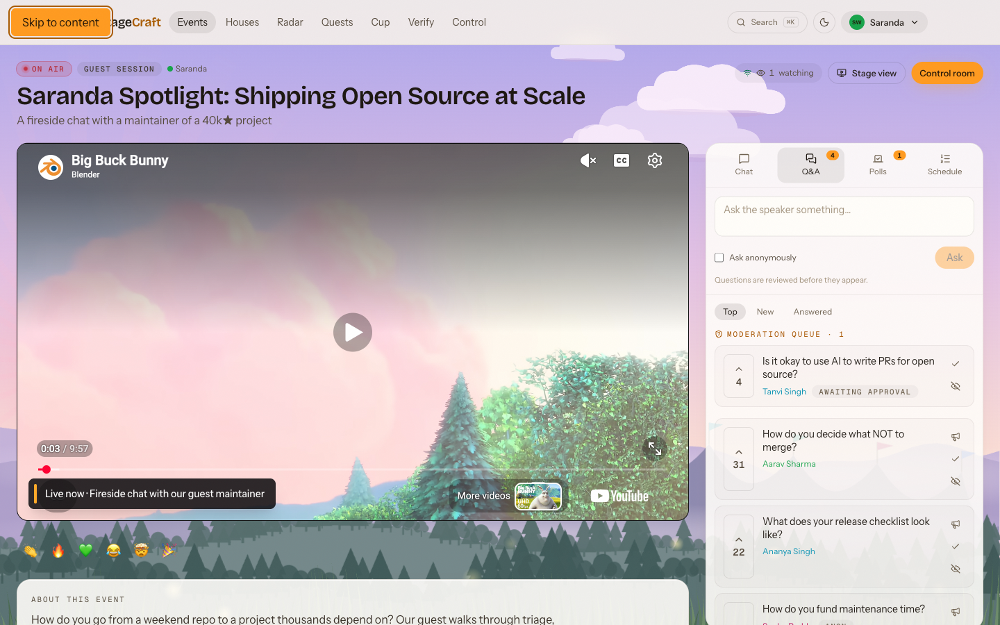
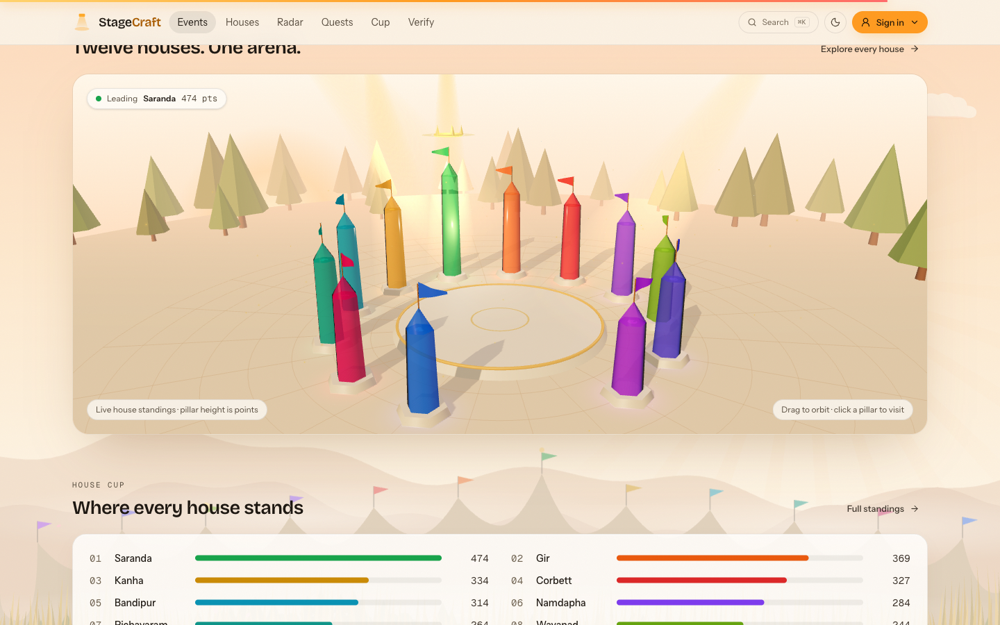
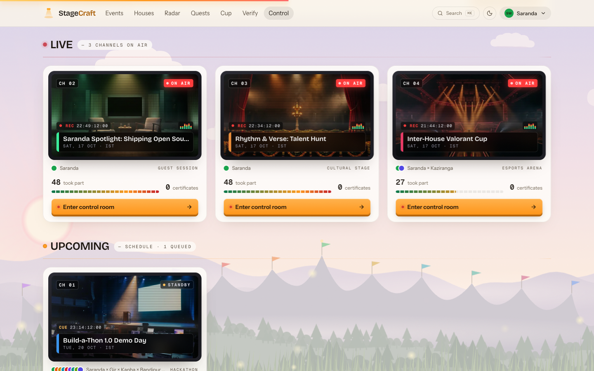
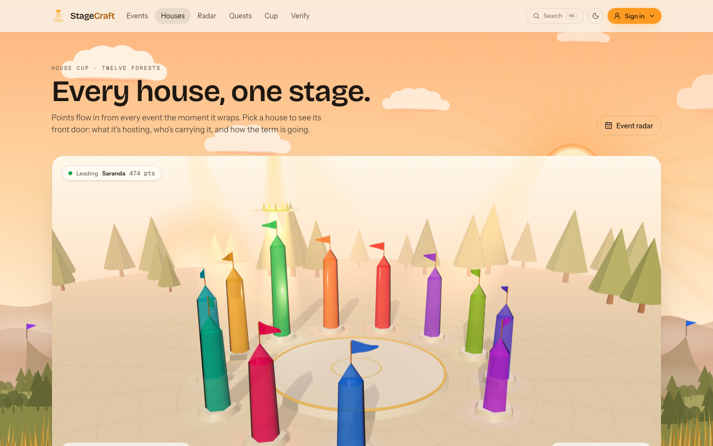
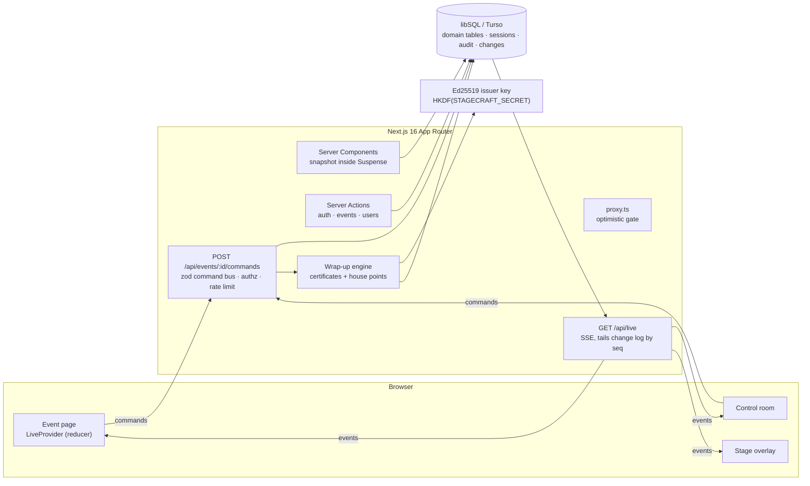

# StageCraft

**Live events where the audience is part of the show.** Built for **Build-a-Thon 1.0, Theme 03: StageCraft (Live Event & Cultural Streamliner)**. It also grows into a complete house platform covering Themes 01, 02 and 04.

**Live:** https://stagecraft-xi.vercel.app · **Repo:** https://github.com/lakshanmuruganandam/stagecraft

[](https://stagecraft-xi.vercel.app)
[](https://github.com/lakshanmuruganandam/stagecraft/actions/workflows/ci.yml)


## Pitch videos and slides

| 1 · Launch film (1:18) | 2 · Technical pitch (2:58) |
|---|---|
| [](https://stagecraft-xi.vercel.app/media/StageCraft-Launch.mp4) | [](https://stagecraft-xi.vercel.app/media/StageCraft-Technical-Pitch.mp4) |
| The product story, from a member's seat to the wrap-up. **[▶ Watch](https://stagecraft-xi.vercel.app/media/StageCraft-Launch.mp4)** · [file in repo](public/media/StageCraft-Launch.mp4) | Architecture, realtime pipeline, security and admin workflows, walked through against the judging rubric. **[▶ Watch](https://stagecraft-xi.vercel.app/media/StageCraft-Technical-Pitch.mp4)** · [file in repo](public/media/StageCraft-Technical-Pitch.mp4) |

**3 · Slides:** [interactive jury deck](https://stagecraft-xi.vercel.app/pitch) (scroll, swipe or use the arrow keys; press F for fullscreen) · [PDF, 13 pages](docs/StageCraft-Jury-Deck.pdf)

**Demo logins:** see [CREDENTIALS.md](CREDENTIALS.md).




| | |
|---|---|
|  |  |
| **Event room**: stream, chat, Q&A, polls, reactions | **House Cup Arena**: WebGL, live standings |
|  |  |
| **Control room monitor wall** for organizers | **House Hub** for every house |

Guest talks, esports cups, talent hunts and hackathon demo days for IITM BS houses run on a patchwork of YouTube links, Google Forms and WhatsApp. StageCraft replaces it with one place to watch, ask, vote, predict and react live. Organizers run the whole show from a single control room, and admins govern users, roles and the audit trail. When a show ends, every winner and participant gets a **cryptographically signed certificate**, and their house gets points.

| | |
|---|---|
| **Stack** | Next.js 16 (App Router, Cache Components, Server Actions, Route Handlers, Proxy) · React 19 · TypeScript (strict) · Drizzle ORM · libSQL / Turso · Tailwind CSS v4 · zod |
| **Realtime** | Server-Sent Events tailing an append-only change log. Works on serverless, resumes without gaps, needs no paid realtime service. |
| **Auth** | Email + password (scrypt), server-side revocable sessions, login throttling, role- and house-scoped authorization, audit log |
| **Credentials** | Ed25519 signatures over canonical JSON, verifiable offline in the browser with WebCrypto |
| **Quality** | ESLint, Vitest unit tests on the domain engines and crypto, GitHub Actions CI, strict CSP |

---

## For judges: try it in 3 minutes

```bash
npm install
npm run dev     # http://localhost:3000. Creates, migrates and seeds .data/stagecraft.db on first request
```

**Demo accounts.** All use the password `house-cup-2026`. The sign-in page fills them in for you, and in demo mode the avatar menu switches between them instantly.

| Account | Role | Try this |
|---|---|---|
| `member@saranda.demo` | Saranda member | Open *Saranda Spotlight* (live). Upvote, vote in the poll, react, chat. Ask a question: it waits in moderation and only you can see it. |
| `guest@kaziranga.demo` | Kaziranga member | The same event in a second window: everything arrives live. Predict the semi-final in the *Valorant Cup*. |
| `organizer@saranda.demo` | Saranda organizer | **Control room**: approve the question and press *Put on stage*, launch a poll, report a bracket score, run the talent-hunt reveal, then **Wrap up** to issue certificates. |
| `admin@saranda.demo` | Admin | Everything, across every house, plus **Users** (roles, suspensions, password resets, sessions), the **Audit log** with CSV export, and **Reset demo data**. |

Then:

1. Open **Stage view** on any event. It's an OBS browser source; add `?transparent=1` to key it over video.
2. As the member, open **Credentials**, then a certificate. Download the **Signed JSON** and drop it on **/verify**. Edit one character and verify again.
3. As the member, open **Account**: change your password and watch your other sessions get signed out.

> **All demo accounts, roles and the password are listed in [CREDENTIALS.md](CREDENTIALS.md). Open it next.**

---

## Feature map (brief → product)

### Interactive Guest Speaker Hub
- **Live Q&A**: submit, upvote (toggle), sort by top/new/answered, ask anonymously.
- **Moderation queue**: pending questions reach the organizer channel and the author only, never the public stream.
- **Spotlight**: *Put on stage* pushes a question to the stage overlay; *Mark answered* archives it.
- **Polls**: 2–6 options, optional timer, **live or sealed results** (tallies are withheld from the audience until close), optional quiz answer, re-voting changes your answer.

### Cultural Stage & Esports Arena
- **Embeds**: YouTube (privacy-enhanced) and Twitch, with a live **lower third** and floating, house-tinted **reactions**.
- **Live chat**: slow mode, pinned message, hide, timed mute, blocklist masking, link and spam limits, database-backed rate limits.
- **Bracket engine**: standard seeding, byes that auto-advance, an optional bronze match, and score corrections that re-route winners but **refuse** to rewrite a match that has already been played.
- **Predictions**: pick while a match is *ready*; picks lock when it goes *live*; the crowd split is shown per match.
- **Talent hunts**: N votes each, no self-votes, judge scores blended with audience share at a weight you choose, tie-aware ranking, **sealed until the reveal**.

### Automated Certificate & Merit Generator
- **Wrap up** (one click, idempotent) computes podiums for every bracket and contest, plus speakers, organizers and every engaged member. It issues certificates and awards house points.
- Recipients get a live "Your certificate is ready" toast.
- Each certificate has a print-ready page (A4 landscape PDF), a **PNG** rendered with `next/og`, a QR code to its verification page, **Add to LinkedIn**, and a **signed JSON** download.
- **Verification**: `/verify/:id` checks the signature and revocation status; `/verify` checks a JSON file **in the browser** against `/.well-known/stagecraft-issuer.json`. Admins and organizers can **revoke** certificates with a reason.

### Beyond Theme 03: one platform for the whole house
- **House Hub (Theme 01):** `/houses` shows a live energy ribbon of every house's share of points; each house gets a home page with art, rank, a points sparkline, a "common room" of what's live, hosted events, top contributors and awards. `/calendar` is an **event radar** (month and agenda views, filters, IST) with `.ics` downloads, a subscribable feed (`/api/calendar/feed.ics`) and Google Calendar links.
- **Proof of presence (Theme 02):** the stage screen shows a **rotating HMAC-signed QR code**. Codes expire every 30 seconds, so they only work in the room. Scanning it records attendance, which counts toward participation certificates and house points.
- **House Odyssey (Theme 04):** a pure achievements engine (12 tiered badges, XP, levels and 12 quests) derived from real activity; public portfolios at `/u/:id` with a **holographic 3D identity card**; and a **quest constellation** at `/quests` with house lore.
- **Spotlight broadcasts:** an admin announcement that dims every connected screen across the platform and spotlights the message, with confetti in the sender's house colour.
- **Command palette:** ⌘K / Ctrl+K jumps to any event or page.
- **Two themes:** *Daylight* (the default: bright paper, crisp ink, living colour) and *Stage* (dark broadcast). Every colour is a CSS-variable token, so whole subtrees can switch; the OBS overlay and video areas stay in Stage.
- **Motion:** a site-wide living background of house-colour light that follows the cursor, a 3D hero built from live data (a real poll, the top question, the live match and a signed certificate), a broadcast-style activity ticker, count-ups, cursor-glow cards, a certificate claim ceremony and a ticket-style sign-in. All of it respects `prefers-reduced-motion`.

### Admin usability & governance
- **Control room** per event: go live and end the show, stage scene switcher, lower thirds, run-of-show editor, poll composer, bracket builder, talent-hunt builder with judging, Q&A moderation, chat tools, audience settings, engagement stats, issued certificates with revoke, the event audit trail, and CSV export.
- **Event editor**: zod-validated Server Actions; times entered in IST; YouTube/Twitch URL validation; organizers must host with their own house.
- **Users** (admins): search and filters, change role or house, suspend with a reason (signs the user out everywhere), reinstate, reset password (one-time password shown once), view and revoke individual sessions, per-user certificates and audit entries.
- **Guardrails enforced on the server**: no self-demotion or self-suspension, the last active admin can't be removed, and organizers must belong to a house.
- **Audit log** (admins): every sign-in, failed login, throttle, role change, moderation action, poll, score, wrap-up and revocation. Filters cover action, actor, event and date, and the CSV export is protected against spreadsheet formula injection.

---

## Roles & permissions

| Capability | Member | Organizer | Admin |
|---|:-:|:-:|:-:|
| Watch, chat, ask, vote, predict, react | ✓ | ✓ | ✓ |
| Own credentials, sessions, password | ✓ | ✓ | ✓ |
| Create events | | ✓ (own house hosts) | ✓ |
| Control room, moderation, wrap-up, revoke | | events their house hosts | all events |
| Users, roles, suspensions, resets | | | ✓ |
| Global audit log + export, reset demo | | | ✓ |

Authorization is decided in one place (`canManageEvent`, `requireAdmin` in `src/lib/auth.ts`) and re-checked on every page, Server Action and command. The Proxy (`src/proxy.ts`) only provides an optimistic redirect for signed-out visitors.

---

## Architecture



### How realtime works
1. Every live mutation is a **command** in `src/server/commands.ts`: a zod schema, an organizer flag and a handler, all dispatched by one endpoint. A new interaction is one new entry.
2. Handlers write domain rows, then **publish** DTOs to channels (`e:<event>` public, `a:<event>` organizers, `u:<user>` personal), which appends to the `changes` table.
3. `/api/live` streams rows with `seq > cursor` for the channels this viewer may read. It wakes instantly from an in-process emitter when writer and reader share an instance, and otherwise polls each second, so it is **correct across any number of serverless instances**. Streams end before platform timeouts, and `EventSource` resumes with `Last-Event-ID` **without gaps**.
4. Pages hydrate from a server **snapshot** whose cursor is read before the data, so racing writes are replayed. The reducer **upserts** by id, so replays are harmless.
5. **Redaction happens in the DTO builders** (`src/server/views.ts`): one function gives the public view (sealed tallies, anonymous authors, no drafts or pending items) and the organizer view.

### Project layout
```
src/
  proxy.ts                   Optimistic route gate (/admin, /account, /me)
  app/
    page.tsx                 Home: live now, schedule, recaps, house cup
    e/[slug]/                Event room · stage/ (OBS overlay)
    admin/                   Dashboard · events/new · events/[id] (control room) · users · audit
    login/ account/ me/      Auth, sessions & password, credentials
    c/[id]/ verify/          Certificate page · verification
    leaderboard/
    actions/auth.ts          Sign-in/up, persona switch, password, session revoke
    api/
      live/                  SSE stream
      events/[id]/commands   Command bus (POST)
      events/[id]/snapshot   Snapshot (GET)
      events/[id]/export     Participant CSV (organizers)
      certificates/[id]      Status + signed payload (JSON, CORS)
      certificates/[id]/image  PNG via next/og
      issuer                 Public JWKS (also /.well-known/stagecraft-issuer.json)
  server/                    commands · queries · views (DTOs) · wrapup
  lib/                       auth · session · password · ratelimit · moderation ·
                             bracket · contest · canonical · certs · live
  components/                live/ (event room), admin/ (control room, users), ui/, site/
  db/                        Drizzle schema · client (auto-migrate) · demo seed
drizzle/                     SQL migrations
tests/                       Vitest
public/covers/ public/houses/   Stage and house art (generated with Gemini via the agy CLI)
```

---

## Security
- **Passwords**: scrypt (N=2¹⁷, r=8, p=1) with per-user salts and constant-time comparison. Unknown emails cost the same time as real ones. The policy follows NIST 800-63B: length over complexity, and common or email-derived passwords are blocked.
- **Sessions**: a random 256-bit token sits in an httpOnly, SameSite=Lax, Secure cookie; only its SHA-256 is stored. Sessions slide over 14 days and can be revoked per device, everywhere, on suspension, or on password change. Suspension takes effect on the next request.
- **Abuse**: login throttled per account (5 tries, refilling slowly) and per network; sign-up throttled per network; chat, vote, question and reaction rate limits in the database; slow mode and mute.
- **No account enumeration**: generic sign-in and sign-up errors.
- **Authorization**: server-side on every action, command and route; organizers are scoped to events their house hosts; commands verify that the target entity belongs to the event.
- **CSRF**: Origin checks on the command endpoint, plus Next's built-in Server Action protection.
- **Headers**: strict CSP (self plus the two video players), `frame-ancestors 'none'`, `nosniff`, a referrer policy, a permissions policy, and HSTS in production.
- **Integrity**: composite primary keys allow one vote per person; counters are recomputed from vote tables; wrap-up and points use dedupe keys.
- **Credentials**: Ed25519 over canonical JSON. The key is derived with HKDF from `STAGECRAFT_SECRET`, so there's no key file. `kid` is embedded in each payload and revocation is checked on verification.
- **Audit**: authentication events and every privileged action are logged with actor and timestamp; the CSV export escapes formula characters.

---

## Deploying

### Vercel + Turso (free tiers)
1. `turso db create stagecraft`, then copy the URL and create a token.
2. Import the repo into Vercel and set:
   - `STAGECRAFT_SECRET`: `openssl rand -base64 48`
   - `DATABASE_URL`, `DATABASE_AUTH_TOKEN` (or link the Turso integration from the Vercel Marketplace, which sets `TURSO_DATABASE_URL` / `TURSO_AUTH_TOKEN`; both names work)
   - `NEXT_PUBLIC_SITE_URL`: the production URL (used in QR codes and LinkedIn links)
   - `STAGECRAFT_DEMO=off` for a real house (hides personas, enforces IITM emails), or leave it on for judging
3. Migrate and seed the remote database once, from your machine (and again after adding migrations):
   ```bash
   DATABASE_URL=… DATABASE_AUTH_TOKEN=… STAGECRAFT_SECRET=… npx tsx --tsconfig tsconfig.json scripts/db-init.ts   # add --reset to reseed demo data
   ```
   Remote databases are never migrated inside a request; local `.data/` databases set themselves up automatically.
4. Deploy.

### Docker (one long-lived Node process, ideal for SSE)
```bash
docker build -t stagecraft .
docker run -p 3000:3000 -e STAGECRAFT_SECRET=... -v $PWD/.data:/app/.data stagecraft
```

See `.env.example` for every option, and [CREDENTIALS.md](CREDENTIALS.md) for the demo accounts to sign in with once it's running.

## Development
```bash
npm run dev          # dev server
npm test             # vitest
npm run typecheck    # tsc (run `npx next typegen` once first)
npm run lint
npm run build
npm run db:generate  # new migration after editing src/db/schema.ts
```

## Roadmap
- Google sign-in restricted to `study.iitm.ac.in` (sessions are provider-agnostic).
- TOTP two-factor authentication for admins.
- Double-elimination and Swiss bracket formats.
- Web push reminders when a registered event goes live.

## License
MIT
